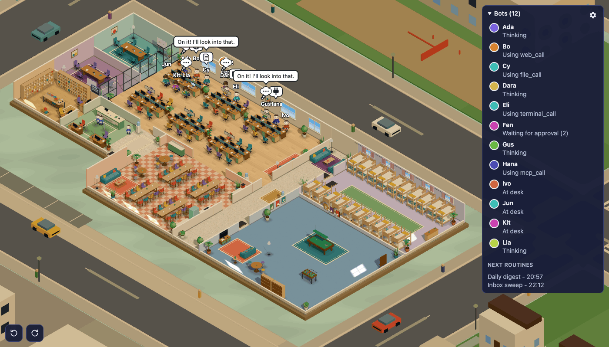
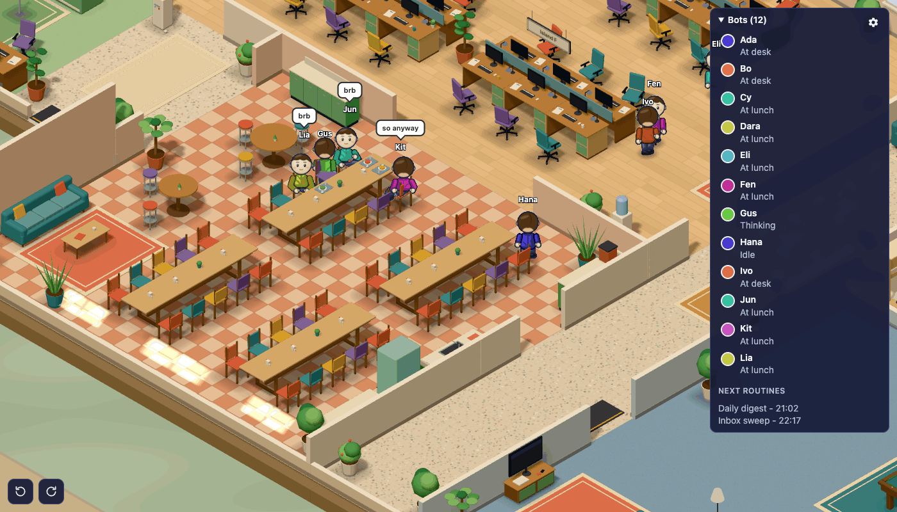
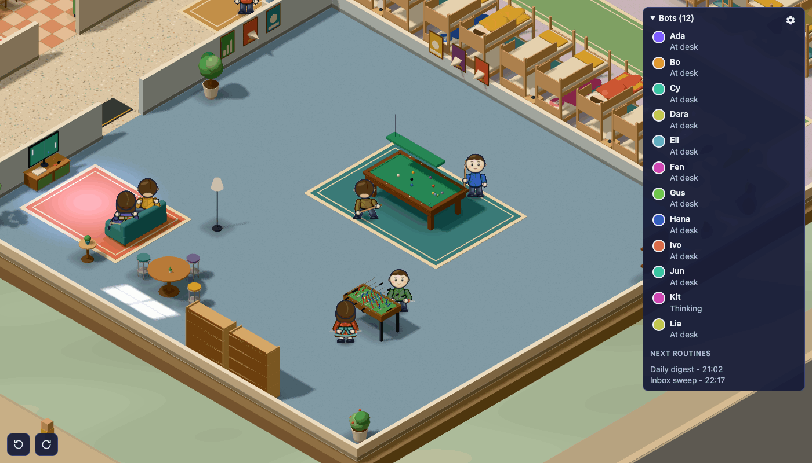
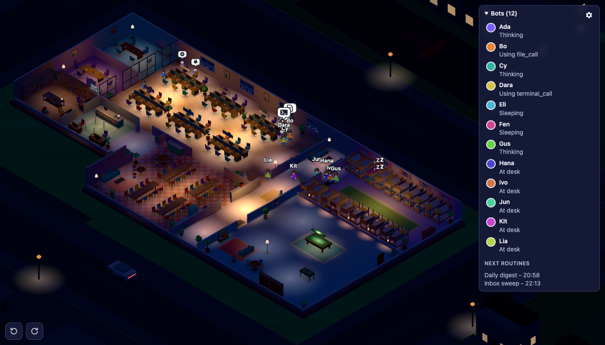

# Orbs Office

> Watch your AI team go to work. A living 3D office for your [Orbs](https://github.com/nikuscs/orbs) bots.

**[See it live: office.vascosousa.com](https://office.vascosousa.com)** - a real team of bots at work right now, shown through the anonymised public mirror.



[Orbs](https://github.com/nikuscs/orbs) runs your own AI bots on your own machine. They think, call tools, ask for approval, message each other and run on schedules, and all of it happens out of sight, in chat threads and logs.

Orbs Office gives that work a place. Every bot becomes a small character in a 3D office that reflects what its bot is really doing, as it happens. A bot that starts a task walks to its desk and starts typing. One that needs your approval queues at the approvals counter. Two bots that message each other meet in a meeting room. When nothing is happening they live an office life: coffee breaks, lunch, a game of pool, and bed.

It is a companion client for Orbs. It pairs with your Orbs daemon like any other device and changes nothing in Orbs itself.

## Why

- **See the whole team at a glance.** Who is working, who is blocked waiting for you, who is talking to whom, without opening a single chat.
- **Stay in the loop without reading logs.** Activity becomes movement: desks, tool icons, the approvals queue, couriers carrying incoming mail.
- **Talk to a bot where it stands.** Click a character to read its recent conversation and send it a message.
- **Show your work without showing your data.** An optional public mirror streams the same office to the web with every piece of text and identity stripped out.
- **It is simply nice to have on a second screen.**

## What you see

| What the bot does in Orbs | What its character does |
| --- | --- |
| Starts thinking | Walks to its desk, sits down and types; the monitor lights up |
| Uses a tool | A bubble shows the kind of tool: terminal, web, files, MCP |
| Waits for your approval | Queues at the approvals counter with a "?" |
| Messages another bot | Both walk to a meeting room and sit at the table |
| Starts subagents | Small interns appear beside its desk |
| Receives a message or a routine fires | A courier carries an envelope from the mailroom to its desk |
| Replies | The reply appears in a speech bubble above its head |
| Fails | A brief "!" |

And when a bot has nothing to do, it follows the office day:

- **Working hours:** at its desk, with short breaks at the kitchen, the water cooler, the lounge or the games room.
- **Lunch:** at the lunch tables with a tray.
- **Games room:** pool and table football in pairs, or the console.
- **After hours:** asleep in its own bed in the dormitory, until work wakes it up.

The building has desk islands you can name, solo desks, two meeting rooms, a mailroom with a routines board, a kitchen, lounges, a dormitory and a games room. The light follows the real clock: sunlight through the windows by day, lamps and glowing monitors at night. Outside there is a small city with traffic.







## Make it yours

- **Faces:** each character wears the avatar its bot has in Orbs.
- **Figures:** choose a male or female figure per bot; female figures wear dresses in the bot's colour.
- **Seating:** put bots on the island you want, or on a solo desk, and name the islands.
- **Hours:** set the working days, the working hours and the lunch break.
- **Lighting:** follow the clock, or keep it always day or always night.

## The public mirror

You can stream your office to a public web page, read-only, for visitors, a lobby screen or your website. The live demo at [office.vascosousa.com](https://office.vascosousa.com) is exactly that.

It is built so that private data cannot leave your machine:

- A small bridge runs next to your daemon and only makes outbound connections. Your daemon and your machine accept nothing from the internet.
- The bridge builds every update from a fixed allow-list: an anonymous id per bot, a public name that you choose, a colour, a figure, a seat, and the kind of activity (idle, thinking, a tool family, waiting, meeting).
- Message text, previews, bot names and handles, avatars, run titles, tool names and inputs, routine names, approval counts, token and cost numbers and server addresses are never sent.
- The public page shows placeholder text in speech bubbles and an invented routines board. It has no chat, no menus, no cookies and no third-party requests.
- A relay on Cloudflare Workers validates every update again before any visitor sees it.

Read [docs/public-mirror.md](docs/public-mirror.md) before you publish. A live mirror still shows how many bots you have and when each one is busy; that is the point of it, and it is your call whether that is fine for you.

## Get started

You need [Bun](https://bun.sh) and a running [Orbs](https://github.com/nikuscs/orbs) daemon.

```sh
git clone https://github.com/sousavf/orbs-office
cd orbs-office
bun install
bun run dev
```

Then:

1. Open `http://localhost:5190`.
2. Get a pairing PIN from Orbs: run `orbs pair`, or `bun run dev:pair` in the Orbs repository for a development daemon.
3. Enter the daemon address and the PIN.

To look around without a daemon, open `http://localhost:5190/?preview&bots=12`. Add `&clock=13:00` for lunch or `&clock=22:00` for the night.

## Controls

- Drag to pan, scroll or pinch to zoom, `0` to refit.
- `Q` and `E`, or the two buttons at the bottom left, rotate the view.
- Hover a character for details. Click it, or its row in the list, to open the chat panel.
- Right-click a bot in the list for its figure, island and public name.
- The gear button opens the office settings.

## How it is built

- [Three.js](https://threejs.org) scene with procedural geometry and sprite characters drawn in code. There are no image, model or audio files.
- [oRPC](https://orpc.dev) over the Orbs daemon's WebSocket, as a normal paired device.
- [Vite](https://vite.dev) and TypeScript.
- [Cloudflare Workers](https://workers.cloudflare.com) with a Durable Object for the public relay.

More detail: [docs/how-it-works.md](docs/how-it-works.md) and [docs/public-mirror.md](docs/public-mirror.md).

## Status

Orbs Office is young. It has been developed against a development Orbs daemon and tested in desktop browsers. The local app currently runs through the Vite development server. Expect rough edges, and please open an issue when you find one.

## Credits

Built for [Orbs](https://github.com/nikuscs/orbs) by [nikuscs](https://github.com/nikuscs). Orbs Office is an independent companion project and is not part of Orbs.

## License

[MIT](LICENSE)
